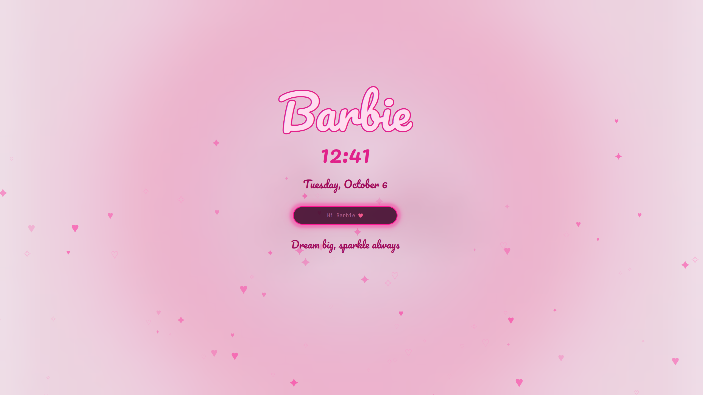

# Omarchy Barbie Extras

Optional extras for the [Omarchy Barbie](https://github.com/BBIEPavkov/omarchy-barbie-theme) and [Barbie Malibu](https://github.com/BBIEPavkov/omarchy-barbie-malibu-theme) themes: a Barbie lock screen, a heart bar, heart popups, a hot pink cursor, and more. They take their colors from whichever theme is active.



## Install

Requires Omarchy 4 (Quattro).

```bash
git clone https://github.com/BBIEPavkov/omarchy-barbie-extras ~/.local/share/omarchy-barbie-extras
~/.local/share/omarchy-barbie-extras/install.sh
```

The script asks before each piece. Run it again any time to add pieces you skipped.

| Extra | What you get |
|-------|--------------|
| Lock screen | Shimmering Barbie logo, script clock and date, floating hearts and sparkles, heart password dots, a sparkle trail and click bursts, sassier messages on each wrong password, confetti on unlock. The layout drifts slowly to avoid burn-in. |
| Bar | Clock in a script font with the date ("Mon, Oct 12  ♥  14:05"), a ♥ on the current workspace, and a slightly taller bar |
| Popups | Volume and brightness levels shown as hearts, and a ♥ on every notification |
| Cursor | Hot pink cursor (a recolor of [Catppuccin Cursors](https://github.com/catppuccin/cursors), GPL-2.0) |
| Windows | Rounded corners, a soft pink glow around the focused window, slightly see-through unfocused windows, and bouncy open/close animations |
| Terminal prompt | Pink ♥ before the folder name, 💔 after a failed command ([Starship](https://starship.rs)) |
| Launcher | "Where to, Barbie…" as the menu prompt |
| Boot and login screens | A BarbieOS logo on black for the boot password screen and the login screen, set again after each `omarchy update` (asks for your password) |

## Uninstall

Removes everything and brings back Omarchy's built-ins:

```bash
~/.local/share/omarchy-barbie-extras/uninstall.sh
```

`omarchy refresh hyprland` resets `~/.config/hypr/hyprland.lua`, which drops the cursor and window extras. Run `install.sh` again and say yes to those two to bring them back.

## Customizing

To customize the lock screen, edit `~/.config/omarchy/plugins/emilypavkov.lock/LockView.qml` (messages, number of hearts) or `Service.qml` (wrong-password messages), then run `omarchy restart shell`.

## Credits

The lock screen bundles [Pacifico](https://github.com/googlefonts/Pacifico) and the bar clock bundles [Dancing Script](https://github.com/googlefonts/DancingScript), both under the SIL Open Font License (see each plugin's `OFL.txt`). The plugins are based on Omarchy's built-in ones ([MIT](https://github.com/basecamp/omarchy/blob/master/LICENSE)).

## Disclaimer

Barbie is a trademark of Mattel, Inc. This is an unofficial fan project and is not affiliated with or endorsed by Mattel.
